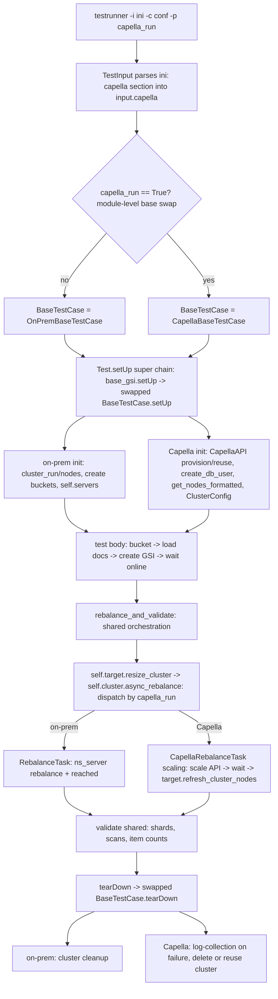
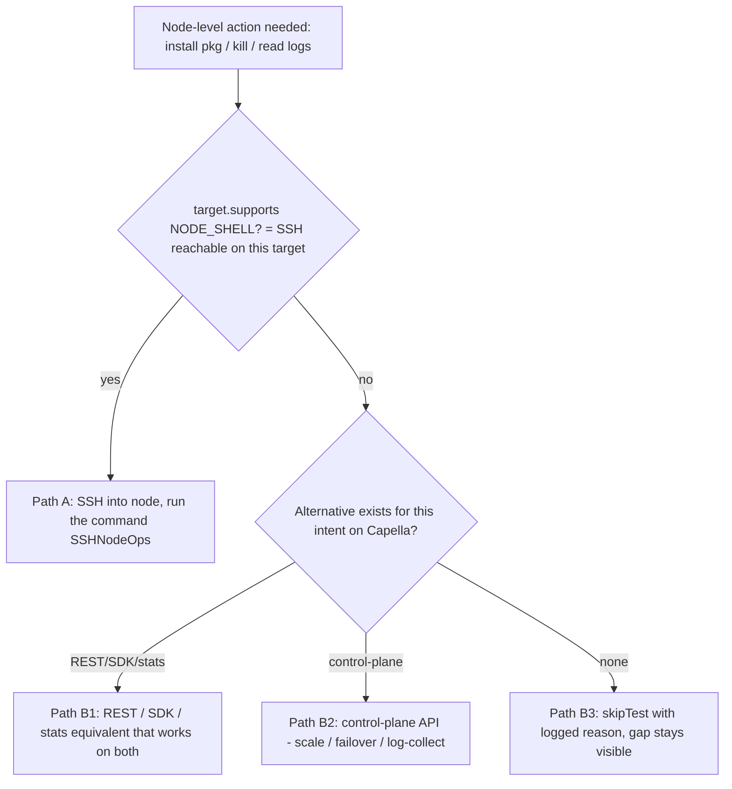

# Dual-run test design — one test body on both on-prem and Capella

---

## 1. Overview & goal

The goal is that **a single test body runs unchanged on both on-prem and Capella**, selected at
runtime by the `capella_run` parameter (`True` → Capella, absent/`False` → on-prem). There are
**no `*_capella` forks** of a test.

**Adoption model:**

- Of the *entire existing* suite, only ~**10%** is migrated to the dual-run structure — a curated,
  representative/sanity subset that serves as reference implementations.
- The remaining ~90% of existing tests are **left as-is (on-prem-only, untouched)**.
- Going forward, ** a subset of tests MUST be dual-run** — it has to pass on both targets.

This document defines *how* we gate target-specific behaviour, how the existing task framework
fits, the challenges and intended solutions, and a worked case study
(`pytests/gsi/gsi_file_based_rebalance.py`).

---

## 2. How target selection already works

The switch is already in the framework. At import time `basetestcase.py` swaps the base class:

```python
# pytests/basetestcase.py (bottom of file)
from capella_basetestcase import BaseTestCase as CapellaBaseTestCase
if TestInputSingleton.input is not None and TestInputSingleton.input.param("capella_run", False):
    BaseTestCase = CapellaBaseTestCase      # pytests/capella_basetestcase.py
else:
    BaseTestCase = OnPremBaseTestCase
```

Every suite that does `from basetestcase import BaseTestCase` therefore runs on Capella when
`capella_run=True` is passed. `CapellaBaseTestCase.setUp()` already provisions **or** reuses a
Capella cluster (`force_deploy_cluster=True` to provision; `cluster_id=...` to reuse), creates the
DB user and buckets, and formats the provisioned nodes into `self.servers` — so downstream test
code that iterates `self.servers` works unchanged.

`capella_run` is supplied as a runtime `-p` param (not a `.conf` field), e.g.:

```
./testrunner -i b/resources/capella/3-nodes-template.ini \
  -c conf/gsi/<suite>.conf \
  -p capella_run=True,cluster_id=<CLUSTER_ID>          # reuse
# or -p capella_run=True,force_deploy_cluster=True     # provision + tear down
```

---

## 3. The gating approach

Three rules, in order of importance:

1. **Tests express *intent*, not *mechanism*.** A test says "restart the indexer" or "rebalance",
   never `RemoteMachineShellConnection(node).execute_command("pkill indexer")`, `diag_eval(...)`,
   or a hardcoded non-TLS port.

2. **Capability — not platform — gates an operation.** A test never branches on `capella_run` to
   decide *how* to do something. It asks whether the current target supports the operation, and
   skips cleanly if not:

   ```python
   if not self.target.supports(Capability.NODE_SHELL):
       self.skipTest("node-shell ops unavailable on this target")
   self.target.restart_service("indexer", node)   # also raises UnsupportedOnTarget as a backstop
   ```

3. **Two independent axes.** Target selection is not one dimension but two, and they are
   independent:

   | | SSH reachable | SSH not reachable |
   |---|---|---|
   | **on-prem** | normal (all node ops) | (not applicable in practice) |
   | **Capella** | node ops **and** control-plane API both usable | control-plane API only; node-shell ops report unsupported |

   SSH can exist on Capella — the `[capella]`. So "Capella ⇒ no SSH" is **not** assumed; SSH availability is a
   probed capability.

### The capability model (and why it does not grow forever)

Capabilities are a **small, fixed enum of coarse access *kinds***, tied to the two axes — **not**
one entry per method:

```python
class Capability(Enum):
    NODE_SHELL       = auto()   # arbitrary commands on a node: install, pkill, reboot, read files
    TOPOLOGY_CONTROL = auto()   # add / remove / rebalance / scale nodes
    NODE_FAILOVER    = auto()   # failover a specific node
    CLUSTER_SETTINGS = auto()   # mutate cluster/index settings via REST
    LOG_ACCESS       = auto()   # trigger / collect service logs (cbcollect / control plane)
    PRIVATE_ENDPOINT = auto()   # Capella-only concept, no on-prem equivalent
    QUERY            = auto()   # run N1QL statements
```

Many methods map onto one category (`install_packages`, `restart_service`, `reboot`,
`read_service_log` all need `NODE_SHELL`), so **adding methods adds zero capabilities**. Each
backend declares a small `CAPS = frozenset({...})`, and `supports(cap)` is just membership.

**Backstop:** base intent-methods `raise UnsupportedOnTarget(cap)` by default, so an
un-overridden op fails loudly. `UnsupportedOnTarget` subclasses `unittest.SkipTest`, so unittest
records it as a skip automatically. There is **no parallel per-method list to drift**, and a test that
forgets to pre-check still degrades to a clean skip rather than an opaque crash.

> Rejected alternative: a per-method `CAPABILITIES = {"restart_service", "reboot", ...}` set. It
> grows in lockstep with the methods and must be hand-kept in sync — exactly the perpetual growth
> we want to avoid.

---

## 4. The seam (implemented design)

All target-specific dispatch lives behind **one per-test facade, `RunTarget`**, reached as
`self.target`. Tests call neutral verbs on it; `RunTarget` decides once, at the dispatch point,
how to execute them. No core framework file (`cluster.py`, `capella_basetestcase.py`) is modified.

```
lib/testops/
├── capabilities.py   # Capability enum + UnsupportedOnTarget (a unittest.SkipTest)
├── node_ops.py       # node-shell backends: SSHNodeOps / CapellaNodeOps
├── query_ops.py      # N1QL backends: NodeQueryOps / ConnectStringQueryOps
└── run_target.py     # RunTarget facade: supports(), node-shell, query and topology verbs
```

### 4a. Base-class wire-up: a lazy `self.target` property

`OnPremBaseTestCase` gains a lazy, cached property (and `CapellaBaseTestCase` inherits it):

```python
# pytests/basetestcase.py — OnPremBaseTestCase
@property
def target(self):
    run_target = getattr(self, "_run_target", None)
    if run_target is None:
        from testops.run_target import RunTarget
        run_target = RunTarget(self)
        self._run_target = run_target
    return run_target
```

`RunTarget` is built on first access, after `setUp` has populated `self.servers`,
`self.cluster` and `self.capella_run`. Tests that never read `self.target` construct nothing, so
non-migrated suites are unaffected.

### 4b. Topology / failover → neutral verbs that delegate to the task manager

`self.cluster` (`couchbase_helper.cluster.Cluster`) already dispatches `async_rebalance` on
`capella_run`: `RebalanceTask` on-prem, `CapellaRebalanceTask` (the scaling API) on Capella.
`RunTarget` wraps it in a verb that names neither "rebalance" nor "scale":

```python
# lib/testops/run_target.py
def resize_cluster(self, add=None, remove=None, services=None):
    return self.test.cluster.async_rebalance(
        self.test.servers[:self.test.nodes_init], add or [], remove or [],
        services=services, cluster_config=getattr(self.test, "cluster_config", None))

def failover_node(self, nodes, graceful=False):
    if self.capella_run:
        raise UnsupportedOnTarget(Capability.NODE_FAILOVER)     # -> clean skip
    return self.test.cluster.async_failover([self.test.master], nodes, graceful)
```

Both return a task (`Future`); call `.result()` to block. Two helpers cover the parts of a
topology change that differ by target:

- `node_to_add(services)`: on-prem returns the spare INI server `servers[nodes_init]`; on Capella
  returns a placeholder carrying `services`, because a scale-out is a *capacity request* and Capella
  provisions the real node.
- `refresh_cluster_nodes()`: on Capella the scale API picks which physical node to add or evict,
  so after a scale it re-reads the live node list and repoints `servers`, `master`, `rest` and
  `cluster_config` (promoting a surviving KV node to master if needed). On-prem it is a no-op.

### 4c. Node-shell / log ops → `NodeOps` backends

For operations that are **not** topology changes (installing packages, killing a process,
rebooting, grepping a log), `RunTarget` delegates to a backend picked from the target:

| Backend | When | `CAPS` |
|---|---|---|
| `SSHNodeOps` | on-prem, or Capella with `-p capella_ssh_reachable=True` | `NODE_SHELL`, `LOG_ACCESS` |
| `CapellaNodeOps` | Capella without SSH (the default) | `LOG_ACCESS` (control-plane log collection only) |

`SSHNodeOps.collect_logs` runs cbcollect via the base `get_cbcollect_info`; `CapellaNodeOps.collect_logs`
triggers control-plane log collection. Reading a node's log file (`read_service_log`) is a shell
operation, so it is gated on `NODE_SHELL`, not `LOG_ACCESS`.

**Capabilities come from the backends.** `RunTarget.supports()` reports the platform capabilities
(topology, failover, settings, private endpoint) plus the `CAPS` declared by the selected
`NodeOps` and `QueryOps` backends. Every backend base method raises `UnsupportedOnTarget`, so a
backend opts in per operation. A new access channel (for example SSM to cloud instances) is
added as a new backend with its own `CAPS` and selected in `make_node_ops` / `make_query_ops`;
no test or `supports()` logic changes.

The base `NodeOps` methods raise `UnsupportedOnTarget`, so an op a backend does not implement
becomes a clean skip rather than a crash. Tests call `self.target.install_packages(...)`,
`restart_service`, `reboot`, `read_service_log` or `collect_logs`, never the backend directly.

### 4d. N1QL → `QueryOps` backends

On Capella a scale-in may evict the very query node a test picked from the services map. So
queries also go through the facade:

| Backend | When | `query_node()` | `run_query(...)` |
|---|---|---|---|
| `NodeQueryOps` | on-prem | a query node from the services map | `n1ql_helper.run_cbq_query` against that node |
| `ConnectStringQueryOps` | Capella | `None` | Python SDK over `couchbases://<srv>`; the SDK picks a live query node |

`run_query` is a drop-in for `n1ql_helper.run_cbq_query`: same `{"results", "status",
"metrics"}` result shape, and it raises `CBQError` on failure. A test can therefore rebind the
helpers once in `setUp`:

```python
if self.capella_run:
    self.run_cbq_query = self.target.run_query
    self.n1ql_helper.run_cbq_query = self.target.run_query
    self.gsi_util_obj.run_query = self.target.run_query
self.n1ql_server = self.target.query_node()
```

### 4e. Terminology — one caller verb, platform-specific task

"Scaling" (Capella) and "rebalance" (on-prem) are the **same caller intent**:

| Caller intent (`self.target.…`) | On-prem | Capella |
|---|---|---|
| `resize_cluster(add=[node_to_add()])` | `RebalanceTask` (rebalance-in) | `CapellaRebalanceTask` (scale-up) |
| `resize_cluster(remove=[n])` | `RebalanceTask` (rebalance-out) | `CapellaRebalanceTask` (scale-down; Capella picks the node) |
| `resize_cluster(add, remove)` | `RebalanceTask` (swap) | `CapellaRebalanceTask` (scale) |
| `failover_node(nodes)` | `FailoverTask` | `UnsupportedOnTarget(NODE_FAILOVER)` → skip |
| `run_query(q, server=query_node())` | REST to a query node | SDK over the connect string |

Why this design over the alternatives: the target is decided **once**, so tests stay
**branch-free**, and a new target (serverless, Goldfish) is a new backend, not an edit to every
test. It replaces the status quo of scattered inline `if self.capella_run` blocks.

### 4f. Temporary `DUALRUN-FLOW` logging

`RunTarget`, the backends and the reference tests log their dispatch decisions with a
`DUALRUN-FLOW:` prefix so a CI run shows which path each step took (`grep DUALRUN-FLOW` in the
test log). This logging is temporary.

**TODO:** remove the `DUALRUN-FLOW` logging once all components have tested the dual-run flow.

---

## 5. Runtime execution flow

How a test actually runs end to end, and where the platform branch happens. The topology step
goes through `self.target.resize_cluster`, which delegates to the **task manager**
(`self.cluster.async_rebalance` → `RebalanceTask` vs `CapellaRebalanceTask`).



> **Rendering note:** Gerrit's markdown viewer does not render mermaid. The diagrams are kept as
> mermaid source here (renders on GitHub/IDEs); rendered images for presentations are produced
> separately and are not committed with this doc.

---

## 6. Challenges → intended solution

For each SSH- or platform-bound operation, the intended approach follows one of four paths.
Confidence is noted where the approach is not yet proven.



- **Path A** — SSH into the node and run the command (works on-prem, and on Capella when SSH is
  reachable).
- **Path B1** — use a REST / SDK / stats equivalent that works on both targets.
- **Path B2** — use a control-plane API equivalent (scale / failover / log-collection).
- **Path B3** — `skipTest` with a logged reason; the coverage gap stays visible.

| Challenge (example call site) | Path | Confidence |
|---|---|---|
| Tool install — `install_tools` apt-get (`gsi_file_based_rebalance.py:1977`) | A if SSH, else B3; long-term B1 (bake into image / not needed on Capella) | Med |
| Process kill / block port / corrupt metadata (`:1612`, `:1737`) | A, else B3 (no cloud equivalent) | High |
| Rebalance / add / remove / swap (`:1751`) | B2 (already implemented) | High |
| Failover (`:1725`) | B2 if API supports it, else B3; today unbranched — gap to fix | Med |
| Node-list refresh after topology change (`:1875`) | B2, Capella-only step hidden inside the task | High |
| Log inspection — `check_gsi_logs_for_shard_transfer` `diag_eval`+zgrep (`:1901`) | B1 (system-event / stats REST), else A, else B3 | Med |
| Disk-fill — `fill_up_disk` `df`/`dd` (`:1989`) | A, else B3 | High |
| Bucket create — `create_standard_bucket port=11222` (`:67`) | B1/B2 control-plane; drop the memcached-port assumption | High |
| Sample-bucket load (`:49`) | B1, else B3 | Med |
| Admin-gated settings — `enable_shard_based_rebalance` (`:51`) | B1 if permitted, else B3 (RBAC 403) | Med |
| Fixed sleeps (`:1716`, `:1880`) | target-aware timeouts (Capella control-plane is slower) | Med |

**Cross-cutting concerns (apply to every dual-run test):** TLS-only ports (Capella forces
`18091`/`18093`/`19102`); client IP allowlisting (`allow_my_ip`); direct memcached admin ops
(prefer SDK/REST); bucket param differences (replicas min 1, eviction/durability defaults);
residual state cleanup on a reused cluster.

---

## 7. Case study — `pytests/gsi/gsi_file_based_rebalance.py`

This file already contains both the pattern and the anti-pattern.

**The anti-pattern:** `test_gsi_rebalance_indexer_node_capella` (`:553`) is a hand-forked copy of
`test_gsi_rebalance_out_indexer_node` (`:58`). The only real differences are that the fork drops
`install_tools()` (SSH) and the bhive `restore_couchbase_bucket()` (SSH), and passes
`capella_rebalance=...`. Dual-run **deletes this fork**.

**The embryonic seam:** `rebalance_and_validate` (`:1707`) already branches inline on
`self.capella_run` for the rebalance (`:1751`), the completion wait (`:1847`), and a Capella-only
node-list refresh (`:1875`). Dual-run **pushes those branches down** behind
`self.target.resize_cluster` / `self.target.refresh_cluster_nodes`. The implemented version is
`FileBasedRebalanceNew` in `pytests/gsi/gsi_file_based_rebalance_new.py`.

### Per-helper classification

| Status | Items |
|---|---|
| ✅ **Dual-run-safe as-is** | index create/build/scan/query, `_return_maps` (`:1601`), `run_post_rebalance_operations` (`:1963`), `run_operation` "after" phase, `load_until_index_dgm` (`:2040`), query load, `stop_rebalance`/`ddl` chaos |
| ⚠️ **Route via facade / normalize** | bucket create (drop `port=11222`, `:67`), sample load (`:49`), `enable_shard_based_rebalance` (`:51`), failover (`:1725`), node-list refresh (`:1875`), fixed sleeps → target-aware |
| ⛔ **Skip on no-SSH (via `supports()`)** | `install_tools` (`:1977`), `fill_up_disk`/`run_disk_usage_tool` (`:1989`/`:2021`), `kill_indexer`/`kill_projector` (`:1612`), `block_indexer_port`/`corrupt_plasma_metadata` (`:1737`), bhive `restore_couchbase_bucket` (`:61`), `check_gsi_logs_for_shard_transfer` (`:1901`) |

### Before / after (rebalance-out test)

```python
# BEFORE: two files. test_gsi_rebalance_out_indexer_node (on-prem) + test_gsi_rebalance_indexer_node_capella (fork)

# AFTER: one test, both targets
def test_gsi_rebalance_out_indexer_node(self):
    self.install_tools()                            # no-op when NODE_SHELL is unsupported
    self._load_and_create_indexes()                 # platform-neutral, unchanged
    out = self.get_nodes_from_services_map("index", get_all_nodes=True)[:2]
    self.rebalance_and_validate(nodes_out_list=out, services_in=["index"])

def install_tools(self):
    if not self.target.supports(Capability.NODE_SHELL):
        return                                      # skip the step, not the whole test
    self.target.install_packages(["stress-ng", "stress", "sysstat", "iptables"])

def rebalance_and_validate(self, nodes_out_list=None, nodes_in_list=None, services_in=None, ...):
    before = self._return_maps()
    task = self.target.resize_cluster(add=nodes_in_list, remove=nodes_out_list,
                                      services=services_in)
    task.result()                                   # on-prem RebalanceTask / Capella scaling
    self.target.refresh_cluster_nodes()             # Capella: re-sync servers/master; on-prem no-op
    self._validate_shards_and_scans(before, ...)    # shared, target-agnostic
```

---

## 8. Conventions & checklists

### Authoring convention — mandatory for all new dual-run tests

1. Never instantiate `RemoteMachineShellConnection`, call `diag_eval`, or hardcode ports / `http://`.
2. Do node/cluster work only through `self.target`: `resize_cluster` / `node_to_add` /
   `refresh_cluster_nodes` / `failover_node` (topology), `install_packages` / `restart_service` /
   `reboot` / `read_service_log` / `collect_logs` (node-shell), `run_query` / `query_node` (N1QL).
3. Gate possibly-unsupported ops with `self.target.supports(cap)`; never branch on `capella_run`
   to decide *how*. If the op is optional, skip the step; if the test is meaningless without it,
   call `self.skipTest(reason)`.
4. Verify via REST / SDK / stats available on both targets.
5. Keep params platform-neutral; let the Capella base normalize (replicas, TLS, topology, bucket
   creation).

### Migration checklist — for the curated ~10% of existing tests

- [ ] Delete any `*_capella` fork; keep one test body.
- [ ] Replace inline `if self.capella_run: capella_api...` with
      `self.target.resize_cluster(...).result()` followed by `self.target.refresh_cluster_nodes()`.
- [ ] Replace `self.cluster.async_failover(...)` with `self.target.failover_node(...)`.
- [ ] Route node-shell calls through `self.target`; gate them with `supports()`.
- [ ] Route N1QL through `self.target.run_query` / `self.target.query_node()`.
- [ ] Remove hardcoded ports / `http://`; drop `port=11222` from bucket creation.
- [ ] Replace fixed sleeps with target-aware waits.
- [ ] Run the test on-prem (regression) **and** on Capella; confirm clean pass or clean skips.

The step-by-step guide for adding a new unified test is in
[pytests/capella/AGENTS.md](../../pytests/capella/AGENTS.md#adding-a-unified-test).

---

## 9. Open questions / risks

- **SSH-reachability probe** — `_probe_ssh()` currently reads the opt-in
  `-p capella_ssh_reachable=True`; a live probe could replace it.
- **Partial seam** — confirm no existing `lib/` helper already abstracts these ops before adding
  `lib/testops/`.
- **Timeout policy** — a central place to scale waits by target.
- **The 10% selection** — the exact existing tests to migrate first, chosen against the blocker
  list in §6.
- **Capella failover** — whether the control-plane API supports node failover, which decides
  Path B2 vs B3 for `RunTarget.failover_node` (today: B3, `UnsupportedOnTarget`).
- **Capella scale-out** — `node_to_add()` returns a capacity-request placeholder; confirm
  `CapellaRebalanceTask` handles it for every service mix.

---

## 10. Not in scope (now)

Backup / XDCR / Eventing / Analytics node ops, and failure-injection
(firewall/stress) beyond `skipTest`, are out of the first cut.
